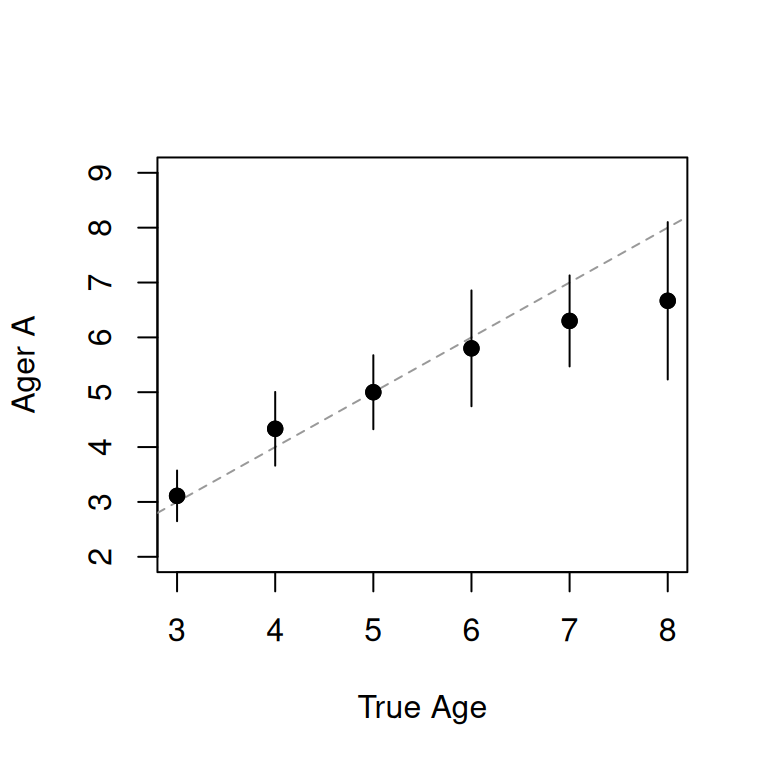

# Age Comparisons in FSA

## Introduction

Information about the age of fish is used to determine rates of
mortality, growth, and maturation, which are key components of
population models used to make fisheries management decisions. Ages of
fish are often estimated by assessing patterns found in calcified
structures such as scales, fin rays or spines, and otoliths. Ages
estimated from calcified structures may not equal the true age of the
fish, may not be the same among different technicians, or may not be the
same between structures. Given the importance of age data in fisheries
management, it is critical to understand sources of variability,
precision, and bias in age estimates.[^1]

The following packages are used herein.

``` r

library(FSA)
library(FSAdata) # for ShadCR data
library(ggplot2) # for graphing
```

In addition, the theme for plots made with `ggplot2` is set to
[`theme_bw()`](https://ggplot2.tidyverse.org/reference/ggtheme.html) for
all plots. Further modifications to the them can be made but are not
here to keep the code as simple as possible.[^2]

``` r

set_theme(theme_bw())
```

## Data Requirements

The true age of each fish must be known to determine the accuracy of age
estimates. Bias among structures or technicians is determined from
paired age estimates for the same fish. Finally, precision among
structures or technicians is examined with two *or more* age estimates
for the same fish.

The data for the example used in [Ogle
(2016)](https://derekogle.com/IFAR/) is in `ShadCR` distributed with
`FSAdata`.[^3] The true ages (`trueAge`) for fish in this sample were
known because the Shad had been marked prior to being stocked.
Additionally, three biologists twice (independently) estimated the age
from scales for each fish. The estimated age variables are labeled with
`ager`, a letter for the three biologists (`A`, `B`, or `C`) and a
number for which time the scale was interpreted (`1` or `2`). Some
biologists chose not to assign an age to some scales and, thus, those
data are missing (shown as `NA` values).

``` r

data("ShadCR",package="FSAdata")  # retrieve data
peek(ShadCR,n=6)
#>     fishID trueAge agerA1 agerA2 agerB1 agerB2 agerC1 agerC2
#> 1   00-LR2       5      5      3     NA     NA      4      3
#> 11   SR-12       3      4      4      4      4      4      3
#> 21 LR15-01       6      3      5     NA     NA      3      3
#> 32 SR-6 03       4     NA     NA     NA     NA     NA     NA
#> 42 LR47-01       5      4      4      5      5      3      2
#> 53 LR54-00       5      6      6     NA     NA      6      3
```

These data will be used herein to examine (1) accuracy by comparing the
estimated ages from a biologist to the known ages (for simplicity, only
the first estimate for a biologist will be used) and (2) precision by
comparing between the two estimates by the same biologist and also by
comparing among the first estimates of all three biologists. Note that
bias is examined as with accuracy, except that two estimated ages are
compared rather than one estimated age compared to the true age. Thus,
separate examples for bias are not shown here.

## Accuracy/Bias Assessment

### Age-Agreement Table

An age-agreement table is a contingency table that shows how two sets of
ages are related. The main diagonal in an age-agreement table represents
the individuals for which the two ages are the same. While it ultimately
does not make a difference which set of estimated ages form the rows and
columns of the age-agreement table, I prefer to have the known or more
reliable ages (I call them the “reference ages”) form the columns.

An age-agreement table can be formed with `FSA` by using
[`ageBias()`](https://fishr-core-team.github.io/FSA/reference/ageBias.md)
with the first argument being a formula of the form `nonrefvar~refvar`,
with `nonrefvar` and `refvar` generically representing the variables
that contain the non-reference and reference ages, respectively. The
data.frame that contains these variables is given in `data=`. Labels for
the reference and non-reference variables may be given in `ref.lab=` and
`nref.lab=`, respectively. The result from
[`ageBias()`](https://fishr-core-team.github.io/FSA/reference/ageBias.md)
should be assigned to an object for post-processing.

``` r

ab.tA1 <- ageBias(agerA1~trueAge,data=ShadCR,
                  ref.lab="True Age",nref.lab="Ager A")
```

[`ageBias()`](https://fishr-core-team.github.io/FSA/reference/ageBias.md)
computes a number intermediate results and summary statistics that can
be specifically extracted with other functions. For example, the
age-agreement table is extracted with
[`summary()`](https://rdrr.io/r/base/summary.html) using the object
saved from
[`ageBias()`](https://fishr-core-team.github.io/FSA/reference/ageBias.md)
and `what="table"`.

``` r

summary(ab.tA1,what="table")
#>       True Age
#> Ager A 2 3 4 5 6 7 8
#>      2 - 1 - - - - -
#>      3 - 6 2 - 1 - -
#>      4 - 2 3 3 - - -
#>      5 - - 3 5 3 3 -
#>      6 - - 1 1 4 3 1
#>      7 - - - 1 - 2 2
#>      8 - - - - 2 2 -
```

Here, for example, it is seen that of the nine true age-3 fish (i.e.,
the 2nd column) Ager A assigned one fish as age 2, six as age 3, and two
as age 4.

### Age-Bias Plot

An *age-bias plot* is used to identify systematic bias between two sets
of ages from the same fish. True ages or ages that are thought to be
more accurate will be considered as the “reference ages”, as mentioned
above. In the traditional age-bias plot, the mean age and associated
confidence interval computed from the non-reference ages for each
reference age is plotted against the corresponding reference age. The
plot is augmented with a 1:1 agreement line (i.e., points where the mean
non-reference and reference ages are equal). Confidence intervals that
do not capture the agreement line indicate a difference (or bias or
inaacuracy) between the mean non-reference and reference ages.

The summary statistics required to construct a traditional age-bias plot
are computed by
[`ageBias()`](https://fishr-core-team.github.io/FSA/reference/ageBias.md)
and stored in the `bias` portion of the assigned object.

``` r

ab.tA1$bias   # ab.tA1 was computed previously (above)
#>   trueAge  n min max     mean        SE          t   adj.p   sig      LCI
#> 1       3  9   2   4 3.111111 0.2003084  0.5547002 1.00000 FALSE 2.649199
#> 2       4 11   3   6 4.333333 0.3015113  1.1055415 1.00000 FALSE 3.661524
#> 3       5 10   4   7 5.000000 0.2981424  0.0000000 1.00000 FALSE 4.325555
#> 4       6 10   3   8 5.800000 0.4666667 -0.4285714 1.00000 FALSE 4.744327
#> 5       7 10   5   8 6.300000 0.3666667 -1.9090909 0.44295 FALSE 5.470542
#> 6       8  3   6   7 6.666667 0.3333334 -3.9999997 0.34315 FALSE 5.232449
#>        UCI canCI
#> 1 3.573023  TRUE
#> 2 5.005142  TRUE
#> 3 5.674445  TRUE
#> 4 6.855673  TRUE
#> 5 7.129458  TRUE
#> 6 8.100884  TRUE
```

For example, the first row above gives the number, minimum, maximum,
mean, and standard error of the first estimated ages of Ager A that were
paired with a true age of 3. Additionally there is a t-test, adjusted
p-value, and a significance statement for testing whether the mean
estimated age is different from the true age of 3. Finally, confidence
intervals (defaults to 95%) for the mean estimated age at a true age of
3 is given, with a statement about whether or not a confidence interval
could be calculated.[^4]

A typical age-bias plot ([Figure 1](#fig-plotAB1)) is created below with
`ggplot2` from the results in the`bias` object. The specifics of the
code below are as follows.

- The base data used in this plot is the `$bias` data.frame discussed
  above.
- The 45^(o) agreement line (i.e., slope of 1 and intercept of 0) is
  added with
  [`geom_abline()`](https://ggplot2.tidyverse.org/reference/geom_abline.html),
  using a dashed `linetype=` and a gray `color=`. This “layer” is first
  so that it sits behind the other results.
- Error bars are added with
  [`geom_errorbar()`](https://ggplot2.tidyverse.org/reference/geom_linerange.html).
  The [`aes()`](https://ggplot2.tidyverse.org/reference/aes.html)thetics
  here map the true age to the `x=` axis and the lower and upper
  confidence interval values for the mean estimated age at each true age
  to `ymin=` and `ymax=`. The `color=` of the lines are mapped to the
  `sig` variable so that points that are significantly different from
  the 45^(o) agreement line will have a different color (with
  [`scale_color_manual()`](https://ggplot2.tidyverse.org/reference/scale_manual.html)
  described below). Finally, `width=0` assures that the error bars will
  not have “end caps.”
- Points at the mean estimated age (`y=`) for each true age (`x=`) are
  added with
  [`geom_point()`](https://ggplot2.tidyverse.org/reference/geom_point.html).
  Again, the `color=` and `fill=` are mapped to the `sig` variable so
  that they will appear different depending on whether the points are
  significantly different from the 45^(o) agreement line or not.
  Finally, `shape=21` represents a plotted point as an open circle that
  is outlined with `color=` and filled with `fill=`.
- [`scale_fill_manual()`](https://ggplot2.tidyverse.org/reference/scale_manual.html)
  and
  [`scale_color_manual()`](https://ggplot2.tidyverse.org/reference/scale_manual.html)
  are used to set the colors and fills for the levels in the `sig`
  variable. Note that `guide="none"` is used so that a legend is not
  constructed for the colors and fills.
- [`scale_x_continuous()`](https://ggplot2.tidyverse.org/reference/scale_continuous.html)
  and
  [`scale_y_continuous()`](https://ggplot2.tidyverse.org/reference/scale_continuous.html)
  are used to set the labels (with `name=`), axis limits, and axis
  breaks for the x- and y-axes, respectively. The same limits are used
  for each axis so that the 45^(o) agreement line can be seen for all
  observed reference ages. The names are drawn from labels that were
  given in the original call to
  [`ageBias()`](https://fishr-core-team.github.io/FSA/reference/ageBias.md)
  and stored in `ab.tA1`.

``` r

ggplot(data=ab.tA1$bias) +
  geom_abline(slope=1,intercept=0,linetype="dashed",color="gray") +
  geom_errorbar(aes(x=trueAge,ymin=LCI,ymax=UCI,color=sig),width=0) +
  geom_point(aes(x=trueAge,y=mean,color=sig,fill=sig),shape=21) +
  scale_fill_manual(values=c("FALSE"="black","TRUE"="white"),guide="none") +
  scale_color_manual(values=c("FALSE"="black","TRUE"="red3"),guide="none") +
  scale_x_continuous(name=ab.tA1$ref.lab,breaks=0:10,limits=c(3,8)) +
  scale_y_continuous(name=ab.tA1$nref.lab,breaks=0:10,limits=c(3,8))
```


Figure 1: Typical age-bias plot between the first estimates of Ager-A
and the true ages.

[Figure 1](#fig-plotAB1) suggests that there is no systematic
inaccuracies between the first age estimates made by Ager A and the true
ages of the Shad as all confidence intervals “capture” the 45^(o)
agreement line. The same plot for the first estimates of Ager-B
demonstrate a systematic inaccuracy ([Figure 2](#fig-plotAB2)), noting
the color coding for the points and intervals for ages that depict a
significant difference.

``` r

ab.tB1 <- ageBias(agerB1~trueAge,data=ShadCR,
                  ref.lab="True Age",nref.lab="Ager B")

ggplot(data=ab.tB1$bias) +
  geom_abline(slope=1,intercept=0,linetype="dashed",color="gray") +
  geom_errorbar(aes(x=trueAge,ymin=LCI,ymax=UCI,color=sig),width=0) +
  geom_point(aes(x=trueAge,y=mean,color=sig,fill=sig),shape=21) +
  scale_fill_manual(values=c("FALSE"="black","TRUE"="white"),guide="none") +
  scale_color_manual(values=c("FALSE"="black","TRUE"="red3"),guide="none") +
  scale_x_continuous(name=ab.tB1$ref.lab,breaks=0:10,limits=c(3,8)) +
  scale_y_continuous(name=ab.tB1$nref.lab,breaks=0:10,limits=c(3,8))
```


Figure 2: Typical age-bias plot between the first estimates of Ager-B
and the true ages.

### Age-Difference Plot

An *age-difference plot* is similar to age-bias plot except that the
mean **difference** (and confidence intervals) between the non-reference
and reference ages are plotted on the y-axis ([Figure 3](#fig-plotAD1)).
With this the agreement line is a horizontal line at 0. Construction of
this plot is similar to above except that the summary results needed for
the plot are in `bias.diff` of the object assigned from
[`ageBias()`](https://fishr-core-team.github.io/FSA/reference/ageBias.md).

``` r

ab.tA1$bias.diff   # ab.tA1 was computed previously (above)
#>   trueAge  n min max       mean        SE          t   adj.p   sig        LCI
#> 1       3  9  -1   1  0.1111111 0.2003084  0.5547002 1.00000 FALSE -0.3508009
#> 2       4 11  -1   2  0.3333333 0.3015113  1.1055415 1.00000 FALSE -0.3384758
#> 3       5 10  -1   2  0.0000000 0.2981424  0.0000000 1.00000 FALSE -0.6744449
#> 4       6 10  -3   2 -0.2000000 0.4666667 -0.4285714 1.00000 FALSE -1.2556734
#> 5       7 10  -2   1 -0.7000000 0.3666667 -1.9090909 0.44295 FALSE -1.5294576
#> 6       8  3  -2  -1 -1.3333333 0.3333334 -3.9999997 0.34315 FALSE -2.7675510
#>         UCI canCI
#> 1 0.5730231  TRUE
#> 2 1.0051424  TRUE
#> 3 0.6744449  TRUE
#> 4 0.8556734  TRUE
#> 5 0.1294576  TRUE
#> 6 0.1008844  TRUE
```

In addition,
[`geom_hline()`](https://ggplot2.tidyverse.org/reference/geom_abline.html)
is used to add the horizontal agreement line at 0, the breaks for the
y-axis need to be adjusted, and the limits for both axes usually need
not be specified.

``` r

ggplot(data=ab.tA1$bias.diff) +
  geom_hline(yintercept=0,linetype="dashed",color="gray") +
  geom_errorbar(aes(x=trueAge,ymin=LCI,ymax=UCI,color=sig),width=0) +
  geom_point(aes(x=trueAge,y=mean,color=sig,fill=sig),shape=21) +
  scale_fill_manual(values=c("FALSE"="black","TRUE"="white"),guide="none") +
  scale_color_manual(values=c("FALSE"="black","TRUE"="red3"),guide="none") +
  scale_x_continuous(name=ab.tA1$ref.lab,breaks=0:10) +
  scale_y_continuous(name=ab.tA1$nref.lab,breaks=-3:2)
```


Figure 3: Age-difference plot for the first estimates of Ager-A and the
true ages.

### Modifications

Both the age-bias and age-difference plots can be modified in a variety
of ways. Some options are demonstrated
[here](https://fishr-core-team.github.io/fishR/blog/posts/2021-3-15-AgeBiasPlots/#more-examples)
and
[here](https://fishr-core-team.github.io/fishR/blog/posts/2023_2_13_Quistetal2022_AgeData/).
In addition, some authors have suggested using a Bland-Altman plot,
which, along with a modification that I prefer, is illustrated
[here](https://fishr-core-team.github.io/fishR/blog/posts/2017-4-20_BlandAltman/).

### Bias Metrics

Modern statistical tests for bias focus on whether an age-agreement
table is symmetric around the main diagonal. An age-agreement table is a
contingency table that shows how two sets of ages are related. The main
diagonal in an age-agreement table represents the individuals for which
the two ages are the same. If there is no systematic bias between the
two ages, then individuals where the paired ages disagree are equally
likely to be above or below this main diagonal. Thus, the age-agreement
table is *symmetric* around the main diagonal if there is no systematic
bias between the two paired ages. [Ogle
(2016)](https://derekogle.com/IFAR/) described three statistical tests
for assessing the symmetry of an age-agreement table – *McNemar test*
(also known as *maximally pooled*), *Evans-Hoenig test* (also known as
*diagonally projected*), and *Bowker test* (also known as *unpooled*).

Calculating all three tests of symmetry is a two-step process that
begins with
[`ageBias()`](https://fishr-core-team.github.io/FSA/reference/ageBias.md)
as described previously for the age-bias plot. Results from the symmetry
tests are displayed by submitting the
[`ageBias()`](https://fishr-core-team.github.io/FSA/reference/ageBias.md)
object to [`summary()`](https://rdrr.io/r/base/summary.html) along with
`what="symmetry"`. Alternatively, use `what="McNemar"`,
`what="EvansHoenig"`, or `what="Bowker"` to show results from the
individual symmetry tests.

``` r

summary(ab.tA1,what="symmetry")   # ab.tA1 was computed previously (above)
#>       symTest df   chi.sq         p
#> 1     McNemar  1 1.580645 0.2086678
#> 2 EvansHoenig  3 2.636364 0.4511502
#> 3      Bowker 10 8.333333 0.5963127
```

The large p-values for all three symmetry tests suggest that the age
estimates of Ager A were not systematically biased relative to the true
ages (i.e., they were accurate).[^5]

To partially illustrate the range of results that may appear in
age-agreement tables and tests of symmetry, the first estimated ages
from Agers B and C were also compared to the true ages. Ager B appeared
to overestimate the age of young fish and underestimate the age of older
fish, resulting in a significantly asymmetric age-agreement table, but
only as detected by the Bowker test.

``` r

# note that ab.tB1 was constructed above
summary(ab.tB1,what="table")
#>       True Age
#> Ager B 3 4 5 6 7 8
#>      3 1 - - - - -
#>      4 5 - - - - -
#>      5 2 3 6 1 1 -
#>      6 - - 1 5 4 2
#>      7 - - - 1 1 -
#>      8 - - - - - -
summary(ab.tB1,what="symmetry")
#>       symTest df    chi.sq         p
#> 1     McNemar  1  0.800000 0.3710934
#> 2 EvansHoenig  2  1.866667 0.3932407
#> 3      Bowker  7 14.800000 0.0386503
```

In contrast, Ager C appeared to underestimate the age of all fish after
age 3, resulting in a significantly asymmetric age-agreement table as
detected by all three symmetry tests.

``` r

ab.tC1 <- ageBias(agerC1~trueAge,data=ShadCR,
                  ref.lab="True Age",nref.lab="Ager C")
summary(ab.tC1,what="table")
#>       True Age
#> Ager C 2 3 4 5 6 7 8
#>      2 - 4 2 1 - - -
#>      3 - 3 6 6 2 2 -
#>      4 - 2 2 2 2 2 -
#>      5 - - - - 5 2 2
#>      6 - - - 1 1 2 1
#>      7 - - - - - 1 -
#>      8 - - - - - 1 -
summary(ab.tC1,what="symmetry")
#>       symTest df   chi.sq            p
#> 1     McNemar  1 30.42222 3.475241e-08
#> 2 EvansHoenig  4 31.78261 2.119129e-06
#> 3      Bowker 16 35.66667 3.218018e-03
```

## Precision

### Precision Metrics

There are three commonly used measures of precision among multiple age
estimates made on the same fish. *Percent agreement* is the percentage
of age estimates for the same fish that either perfectly agree or agree
within a certain amount (e.g., within two years of each other). *Average
percent error* (APE) is defined as

``` math
 APE = 100 * \frac{\sum_{j=1}^{n}\sum_{i=1}^{R}\frac{\left|x_{ij}-\bar{x}_{j}\right|}{\bar{x}_{j}}}{nR} 
```

where $`x_{ij}`$ is the $`i`$th age for the $`j`$th fish,
$`\bar{x}_{j}`$ is the mean age for the $`j`$th fish, $`R`$ is the
number of times that each fish was aged (assumed to be the same for all
fish), and $`n`$ is the number of aged fish in the sample. Finally, the
*average coefficient of variation* (ACV) is defined as

``` math
 ACV = 100 * \frac{\sum_{j=1}^{n}\frac{s_{j}}{\bar{x}_{j}}}{n} 
```

where $`s_{j}`$ is the standard deviation of the $`R`$ age estimates for
the $`j`$th fish.

All three measures of precision are calculated in a two-step process
that begins with
[`agePrecision()`](https://fishr-core-team.github.io/FSA/reference/agePrecision.md)
from `FSA`. The first argument to
[`agePrecision()`](https://fishr-core-team.github.io/FSA/reference/agePrecision.md)
is a formula of the form `~var1+var2+...`, where `var1`, `var2`, etc.
are the variables that contain the multiple age estimates.[^6] The
data.frame that contains the variables must be given in `data=`. Again,
the result should be assigned to an object for post-processing. For
example, precision between the two age estimates made by Ager A is
assessed below.

``` r

ap.A <- agePrecision(~agerA1+agerA2,data=ShadCR)
```

Two types of percentage agreement tables may be extracted by submitting
the
[`agePrecision()`](https://fishr-core-team.github.io/FSA/reference/agePrecision.md)
object to [`summary()`](https://rdrr.io/r/base/summary.html). The
percentage table of raw differences is extracted with
`what="difference"`.

``` r

summary(ap.A,what="difference")
#>     -2     -1      0      1      2      3 
#>  3.922 15.686 50.980 19.608  7.843  1.961
```

These results show that both estimates by Ager A agreed for 51.0% of the
fish and that the second estimate was two years older for 3.9% of the
fish, but two years younger for 7.8% of the fish.

Use `what="absolute difference"` to extract the percentage table of the
absolute value of the differences.

``` r

summary(ap.A,what="absolute difference")
#>      0      1      2      3 
#> 50.980 35.294 11.765  1.961
```

These results show that the two age estimates agreed for 51.0% of the
fish (as above) and differed by two years (either way) for 11.8% of the
fish.

The APE and ACV (along with average standard deviation (ASD) and average
absolute deviation (AAD)) are extracted by including `what="precision"`
in [`summary()`](https://rdrr.io/r/base/summary.html).

``` r

summary(ap.A,what="precision")
#>   n validn R PercAgree    ASD   ACV    AAD   APE
#>  53     51 2     50.98 0.4575 9.739 0.3235 6.887
```

The age precision results may be computed for more than two age
estimates. For example, the results below examine precision among the
first readings made by all three agers.[^7]

``` r

ap.ABC <- agePrecision(~agerA1+agerB1+agerC1,data=ShadCR)
summary(ap.ABC,what="difference")
#>                     -2     -1      0      1      2      3      4
#> agerA1 - agerB1 18.182 15.152 45.455 12.121  9.091  0.000  0.000
#> agerA1 - agerC1  0.000  5.882 19.608 41.176 19.608 11.765  1.961
#> agerB1 - agerC1  0.000  6.061  6.061 36.364 36.364 15.152  0.000
summary(ap.ABC,what="precision")
#>   n validn R PercAgree   ASD   ACV  ACV2    AAD  APE  APE2    AD
#>  53     33 3     6.061 1.001 22.98 24.94 0.7273 16.7 14.27 13.27
```

## Other Considerations

### Built-In Age-Bias Plot

A quick-and-dirty, not publication quality, traditional age-bias plot
may be constructed from
[`ageBias()`](https://fishr-core-team.github.io/FSA/reference/ageBias.md)
object with
[`plotAB()`](https://fishr-core-team.github.io/FSA/reference/plotAB.md).

``` r

plotAB(ab.tA1)
```



### Individual Fish

The objects returned from
[`ageBias()`](https://fishr-core-team.github.io/FSA/reference/ageBias.md)
and
[`agePrecision()`](https://fishr-core-team.github.io/FSA/reference/agePrecision.md)
contain intermediate calculations for individual fish that can be used
for further analysis. For example, `data` in the
[`ageBias()`](https://fishr-core-team.github.io/FSA/reference/ageBias.md)
object contains the original two age estimates along with the difference
and the mean of those two estimates. Some authors have used these data
to create mixed models to assess components that might contribute to
ageing error ([here is one
example](https://meridian.allenpress.com/jfwm/article/15/1/203/501110/Use-of-Fin-Rays-and-Fin-Spines-in-Nonlethal-Age)).

``` r

peek(ab.tA1$data,n=6)
#>    agerA1 trueAge diff mean
#> 1       5       5    0  5.0
#> 11      4       3    1  3.5
#> 21      3       6   -3  4.5
#> 32     NA       4   NA   NA
#> 42      4       5   -1  4.5
#> 53      6       5    1  5.5
```

`detail` in the
[`agePrecision()`](https://fishr-core-team.github.io/FSA/reference/agePrecision.md)
object contains a variety of information related to the estimates for
the individual fish, including the individual level CV and PE.[^8] One
example of individual-based analyses that may derive from these data is
[shown
here](https://fishr-core-team.github.io/fishR/blog/posts/2015-9-5_Age_Comparison_Results/).

``` r

peek(ap.A$detail,n=6)
#>    agerA1 agerA2 mean median mode       SD       CV      CV2 AD PE PE2  D
#> 1       5      3    4      4   NA 1.414214 35.35534 35.35534  1 25  25 25
#> 11      4      4    4      4    4 0.000000  0.00000  0.00000  0  0   0  0
#> 21      3      5    4      4   NA 1.414214 35.35534 35.35534  1 25  25 25
#> 32     NA     NA   NA     NA   NA       NA       NA       NA NA NA  NA NA
#> 42      4      4    4      4    4 0.000000  0.00000  0.00000  0  0   0  0
#> 53      6      6    6      6    6 0.000000  0.00000  0.00000  0  0   0  0
```

[^1]: These are common terms that are discussed elsewhere, including in
    [Ogle (2016)](https://derekogle.com/IFAR/).

[^2]: For example, see [this
    post](https://fishr-core-team.github.io/fishR/blog/posts/2022-12-22_AFS_Style_Figures/).

[^3]: More information about the date [is
    here](https://fishr-core-team.github.io/FSAdata/reference/ShadCR.html).

[^4]: See [the
    documentation](https://fishr-core-team.github.io/FSA/reference/ageBias.html)
    for
    [`ageBias()`](https://fishr-core-team.github.io/FSA/reference/ageBias.md)
    for the criterion used to decide if the confidence interval can be
    calculated.

[^5]: It would be useful to make an age-bias plot here as well.

[^6]: If only two variables are being considered, then the formula to
    [`agePrecision()`](https://fishr-core-team.github.io/FSA/reference/agePrecision.md)
    may be the same as that used in
    [`ageBias()`](https://fishr-core-team.github.io/FSA/reference/ageBias.md).

[^7]: The sample size is much smaller in the example where the three
    agers are compared because Ager C did not estimate an age for
    several fish.

[^8]: See
    [documentation](https://fishr-core-team.github.io/FSA/reference/agePrecision.html)
    for
    [`agePrecision()`](https://fishr-core-team.github.io/FSA/reference/agePrecision.md)
    for more details.
