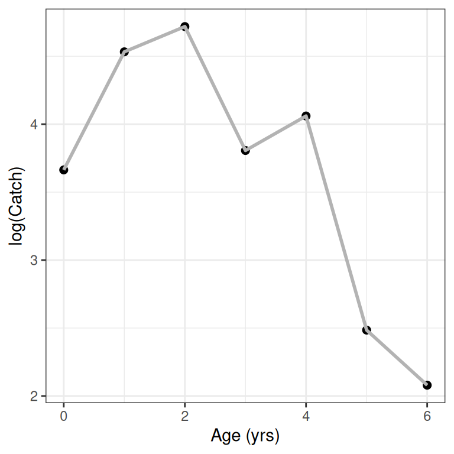
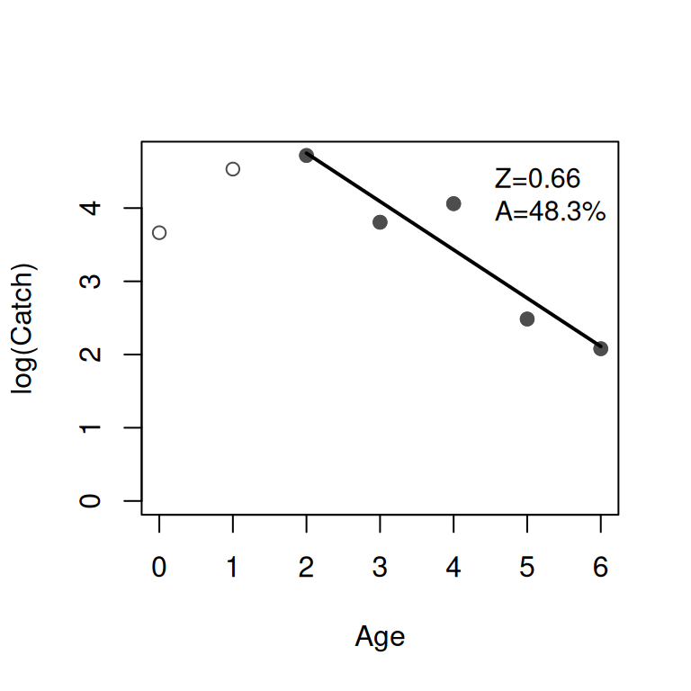
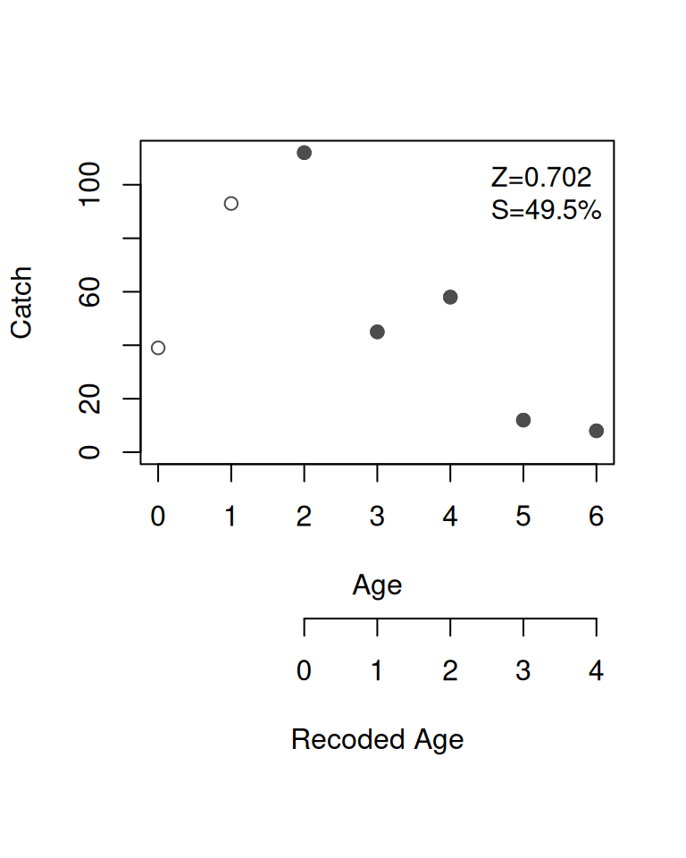
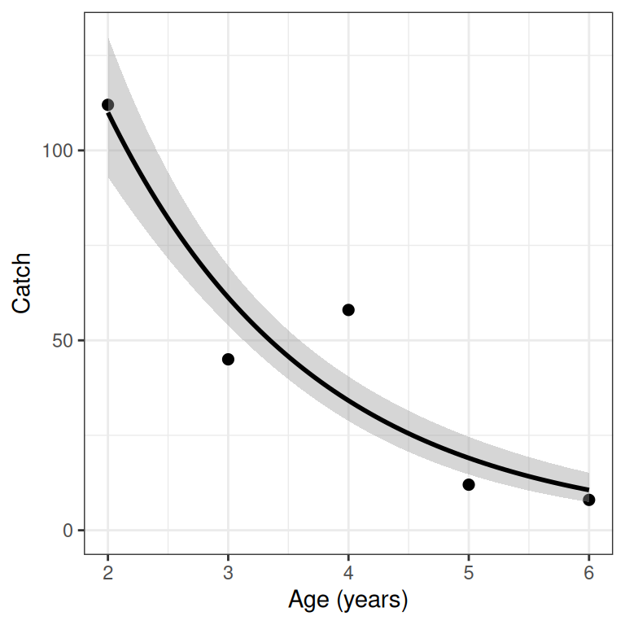
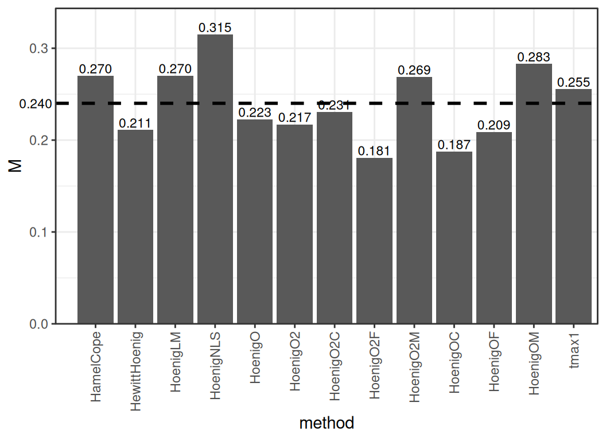

# Mortality Estimates in FSA

## Introduction

The objective of this article is to briefly describe how to use
functions in `FSA` to estimate total and component mortality rates with
methods commonly used in fisheries. It assumes that you are familiar
with data and methods commonly used to estimate mortality, which are
discussed in most fisheries science books including [Introductory
Fisheries Analyses with R](https://derekogle.com/IFAR/).

The following packages are used herein.

``` r

library(FSA)
library(ggplot2) # for graphing
```

## Total Mortality – Catch-Curves

Methods that use the frequencies of fish at each age to estimate
mortality rates are commonly referred to as *catch curve methods*. There
are three common catch-curve methods used to estimate *instantaneous
total mortality* ($`Z`$), which can be easily converted to *annual total
mortality rate* ($`A`$) – linear regression models, Chapman-Robson
method, or general linear models. Linear regression models are the most
commonly used method, but recent authors have strongly suggested that
they should **not be used** (see
[here](https://www.researchgate.net/publication/374443277_Estimating_fish_mortality_rates_from_catch_curves_A_plea_for_the_abandonment_of_Ricker_1975's_linear_regression_method)
and
[here](https://www.researchgate.net/publication/262822831_Recommendations_for_Catch-Curve_Analysis)).

Due to gear selectively, most catch-at-age data will have an ascending
limb with fish of ages not yet fully recruited to the gear, a peak where
fish are beginning to fully recruit to the gear, and a descending limb
where fish are fully recruited to the gear but the frequency is
declining due to the cumulative mortality over time. Catch-curve methods
are applied to the descending limb only. A variety of rules have been
proposed to objectively define the descending limb of a catch curve.
Most commonly, the peak has been defined as the age, or one year older
than the age, with the greatest catch. Several rules[^1] have also been
used to truncate the right side of the descending limb in an attempt to
reduce the bias in estimates of $`Z`$ associated with few fish of older
ages.

Catch curve methods will be demonstrated in this article with
catches-at-age of Brook Trout captured in Tobin Harbor (Michigan) from
1996-1998. These data are simple and, thus, are entered directly into a
data.frame below but these data could have been entered into an external
file and then loaded into R. Additionally, catch-at-age data often
result from summarizing ages recorded for individuals or derived from an
age-length key (see [the Age-Length Key
article](https://fishr-core-team.github.io/FSA/articles/Age_Length_Keys.html)).

``` r

bkt <- data.frame(age=0:6,
                  ct=c(39,93,112,45,58,12,8))
```

A plot of log catch versus age ([Figure 1](#fig-CatchCurveBrkTrt1))
suggests that ages 2 through 6 define the descending limb of the catch
curve for these data.

``` r

ggplot(data=bkt,mapping=aes(x=age,y=log(ct))) +
  geom_point(size=2) +
  geom_line(color="gray70",linewidth=1) +
  scale_y_continuous(name="log(Catch)") +
  scale_x_continuous(name="Age (yrs)") +
  theme_bw()
```



Figure 1: Log catch-at-age of Tobin Harbor Brook Trout.

### Linear Regression Models

Instantaneous total mortality rate ($`Z`$) may be estimated by the slope
of the linear regression of log catch on age for the descending limb of
the catch-curve. This estimate is often biased (low). An *ad hoc*
weighting scheme has often been used to adjust for this bias.

The unweighted linear regression method is implemented in
[`catchCurve()`](https://fishr-core-team.github.io/FSA/reference/catchCurve.md)
with a first argument as a formula of the form `catch~age`, where
`catch` and `age` generically represent the variables that contain the
catch and age data. The data.frame that contains `catch` and `age` is
given in `data=`. This data.frame does NOT have to be restricted to only
ages on the descending limb of the catch curve. However, if ages are
included in the data.frame that are not on the descending limb, then the
ages on the descending limb must be given as a vector in
`ages2use=`.[^2] The result of
[`catchCurve()`](https://fishr-core-team.github.io/FSA/reference/catchCurve.md)
should be assigned to an object that can be submitted to
[`summary()`](https://rdrr.io/r/base/summary.html) to extract the
estimates of $`Z`$ and $`A`$ and to
[`confint()`](https://rdrr.io/r/stats/confint.html) for confidence
intervals.[^3] These results are column-bound together here with
[`cbind()`](https://rdrr.io/r/base/cbind.html) to make a succinct
summary table.

``` r

thcc <- catchCurve(ct~age,data=bkt,ages2use=2:6)
cbind(summary(thcc),confint(thcc))
#>    Estimate Std. Error  t value   Pr(>|t|)    95% LCI   95% UCI
#> Z  0.659987   0.136741 4.826549 0.01695159  0.2248162  1.095158
#> A 48.314197         NA       NA         NA 20.1337012 66.551321
```

A quick (i.e., not publication quality) plot to illustrate the results
is created by submitting the
[`catchCurve()`](https://fishr-core-team.github.io/FSA/reference/catchCurve.md)
object to [`plot()`](https://rdrr.io/r/graphics/plot.default.html)
([Figure 2](#fig-CatchCurveBrkTrt2)).[^4]

``` r

plot(thcc)
```



Figure 2: Log catch-at-age for Tobin Harbor Brook Trout showing the
linear regression results on the descending limb.

The *ad hoc* weighted linear regression method is implemented exactly as
described above but by including `weighted=TRUE` in
[`catchCurve()`](https://fishr-core-team.github.io/FSA/reference/catchCurve.md).

``` r

thccw <- catchCurve(ct~age,data=bkt,ages2use=2:6,weighted=TRUE)
cbind(summary(thccw),confint(thccw))
#>     Estimate Std. Error t value   Pr(>|t|)   95% LCI   95% UCI
#> Z  0.6430183  0.1417433  4.5365 0.02004993  0.191928  1.094109
#> A 47.4296703         NA      NA         NA 17.463369 66.516206
```

### Chapman-Robson Method

The Chapman-Robson method is implemented in
[`chapmanRobson()`](https://fishr-core-team.github.io/FSA/reference/chapmanRobson.md)
using the same arguments as used with
[`catchCurve()`](https://fishr-core-team.github.io/FSA/reference/catchCurve.md).

``` r

thcr <- chapmanRobson(ct~age,data=bkt,ages2use=2:6)
cbind(summary(thcr),confint(thcr))
#>     Estimate Std. Error    95% LCI    95% UCI
#> S 49.4600432  2.3260749 44.9010202 54.0190662
#> Z  0.7018264  0.1153428  0.4757586  0.9278941
plot(thcr)
```



Figure 3: Catch-at-age for Tobin Harbor Brook Trout showing the
descending limb and the “re-coded” ages used in the Chapman-Robson
method.

The default for
[`chapmanRobson()`](https://fishr-core-team.github.io/FSA/reference/chapmanRobson.md)
is to use the preferred bias-correction proposed by [Smith *et al.*
(2012)](https://www.researchgate.net/publication/262822831_Recommendations_for_Catch-Curve_Analysis).
Other less-preferred methods may be used with `zmethod=`, as described
in [the `chapmanRobson()`
documentation](https://fishr-core-team.github.io/FSA/reference/chapmanRobson.html).

### Poisson GLM

`FSA` does not provide any functions to assist with using general linear
models to estimates $`Z`$. However, R code is provided in an appendix to
[this useful
article](https://www.researchgate.net/publication/352695018_An_improved_method_for_the_estimation_and_comparison_of_mortality_rates_in_fish_from_catch-curve_data)
that thoroughly demonstrates this method, along with important
diagnostic tools. Part of this method is introduced below to help one
get started with the code provided in that article.

Simple general linear models can be fit in R with
[`glm()`](https://rdrr.io/r/stats/glm.html). In this application, the
data must first be restricted to the catch of fish only at those ages on
the descending limb of the catch-curve. In this example (as shown
above), this was for ages 2-6, which for these data is simply all ages
greater than age-2. The code below creates a new data.frame using
[`filter()`](https://dplyr.tidyverse.org/reference/filter.html) from
`dplyr` with just those ages.[^5]

``` r

bkt2 <- bkt |>
  dplyr::filter(age>=2)
bkt2
#>   age  ct
#> 1   2 112
#> 2   3  45
#> 3   4  58
#> 4   5  12
#> 5   6   8
```

The first two arguments to [`glm()`](https://rdrr.io/r/stats/glm.html)
are the same as for
[`catchCurve()`](https://fishr-core-team.github.io/FSA/reference/catchCurve.md)
and
[`chapmanRobson()`](https://fishr-core-team.github.io/FSA/reference/chapmanRobson.md)
– i.e., a formula of the form `catch~age` with the data.frame given in
`data=`. The Poisson regression is declared by including
`family="poisson"` in [`glm()`](https://rdrr.io/r/stats/glm.html). The
result of [`glm()`](https://rdrr.io/r/stats/glm.html) shouled be
assigned to an object.

``` r

thpglm <- glm(ct~age,data=bkt2,family="poisson")
```

The model parameter estimates and other useful information are extracted
from the [`glm()`](https://rdrr.io/r/stats/glm.html) object with
[`summary()`](https://rdrr.io/r/base/summary.html). The parameter
estimates only can be retained by appending `$coefficients` to the
[`summary()`](https://rdrr.io/r/base/summary.html) call. Confidence
intervals are extracted with
[`confint()`](https://rdrr.io/r/stats/confint.html). These results are
column-bound together to provide a result similar to what was returned
from
[`catchCurve()`](https://fishr-core-team.github.io/FSA/reference/catchCurve.md)
and
[`chapmanRobson()`](https://fishr-core-team.github.io/FSA/reference/chapmanRobson.md).

``` r

cbind(summary(thpglm)$coefficients,confint(thpglm))
#> Waiting for profiling to be done...
#>               Estimate Std. Error   z value      Pr(>|z|)      2.5 %     97.5 %
#> (Intercept)  5.8700274 0.17973630  32.65911 5.949817e-234  5.5164089  6.2215897
#> age         -0.5849019 0.05630593 -10.38793  2.814037e-25 -0.6978798 -0.4769085
```

The results returned in the `(Intercept)` row can be largely ignored.
Information for $`Z`$ is in the second row which will be labeled with
the name of your “age” variable. Note that this information is actually
for $`-Z`$ as the $`Z`$ is the negative slope of the descending limb,
and [`glm()`](https://rdrr.io/r/stats/glm.html) is simply returning the
value of that slope. Thus, the estimate of $`Z`$ is 0.585 with a 95%
confidence interval of 0.477-0.698.

The fitted line (with confidence band) from the Poisson regression can
be added to a `ggplot2` object with
[`geom_smooth()`](https://ggplot2.tidyverse.org/reference/geom_smooth.html)
using `method="glm"` and `method.args=list(family=poisson)`
([Figure 4](#fig-PoissonFit)).

``` r

ggplot(data=bkt2,mapping=aes(x=age,y=ct)) +
  geom_point(size=2) +
  geom_smooth(method="glm",method.args=list(family=poisson),color="black") +
  scale_y_continuous(name="Catch",limits=c(0,NA)) +
  scale_x_continuous(name="Age (years)") +
  theme_bw()
#> `geom_smooth()` using formula = 'y ~ x'
```



Figure 4: Catch-at-age (untransformed catch-curve) for Tobin Harbor
Brook Trout with the Poisson regression line and 95% confidence band
shown.

Properly estimating $`Z`$ using general linear models is more complex
(but not more complicated) then what is shown here. Please consult [the
article](https://www.researchgate.net/publication/352695018_An_improved_method_for_the_estimation_and_comparison_of_mortality_rates_in_fish_from_catch-curve_data)
mentioned above for a more complete explanation and example of this
method.

## Total Mortality - Capture-Recapture

Estimates of *apparent survival* from one time period to the next can be
estimated for open populations using capture-recapture data.
Traditionally, these methods used $`\phi`$ rather than $`S`$ to
represent the survival rate, a convention that is also used here.

These methods generally require data from individually tagged fish
recorded in the *capture history format*. The same capture history data
for Cutthroat Trout greater than 180 mm captured from Auke Lake (Alaska)
during the summers of 1998-2006 used in [the Mark-Recapture
article](https://fishr-core-team.github.io/FSA/articles/Mark_Recapture.html)
are used here. These data are loaded, capture histories are summarized,
and the Method B table observed as shown below.[^6].

``` r

data(CutthroatAL)
peek(CutthroatAL,n=6)
#>        id y1998 y1999 y2000 y2001 y2002 y2003 y2004 y2005 y2006
#> 1       1     0     0     0     0     0     0     0     0     1
#> 337   337     0     0     0     0     0     0     1     0     0
#> 674   674     0     0     0     0     0     1     1     1     1
#> 1010 1010     0     0     0     1     0     0     0     0     0
#> 1347 1347     0     1     0     0     0     0     0     0     0
#> 1684 1684     1     1     1     0     0     0     0     0     0
cut.ch <- capHistSum(CutthroatAL,cols2use=-1)
cut.ch$methodB.top
#>     i=1 i=2 i=3 i=4 i=5 i=6 i=7 i=8 i=9
#> j=1  NA  22   4   0   0   0   0   0   0
#> j=2  NA  NA  90   4   2   0   0   0   0
#> j=3  NA  NA  NA  37  13   1   0   0   0
#> j=4  NA  NA  NA  NA  43   2   1   0   0
#> j=5  NA  NA  NA  NA  NA  96   2   2   0
#> j=6  NA  NA  NA  NA  NA  NA  88  10   1
#> j=7  NA  NA  NA  NA  NA  NA  NA  40   4
#> j=8  NA  NA  NA  NA  NA  NA  NA  NA  13
#> j=9  NA  NA  NA  NA  NA  NA  NA  NA  NA
cut.ch$methodB.bot
#>   i=1 i=2 i=3 i=4 i=5 i=6 i=7 i=8 i=9
#> m   0  22  94  41  58  99  91  52  18
#> u  89 330 198 192 201 271 199  82 122
#> n  89 352 292 233 259 370 290 134 140
#> R  89 352 292 233 259 370 290 134   0
```

The Jolly-Seber method was introduced in [the Mark-Recapture
article](https://fishr-core-team.github.io/FSA/articles/Mark_Recapture.html)
as a method to estimate abundance in an open population. When three or
more samples of marked fish have been collected, the Jolly-Seber method
can also be used to estimate the apparent survival ($`\phi_{i}`$) from
sampling event $`i`$ to $`i+1`$. The specifics underlying this method
are described elsewhere, including in [Introductory Fisheries Analyses
with R](https://derekogle.com/IFAR/).

Jolly-Seber calculations are performed by submitting the
[`capHistSum()`](https://fishr-core-team.github.io/FSA/reference/capHistSum.md)
object to
[`mrOpen()`](https://fishr-core-team.github.io/FSA/reference/mrOpen.md)
from `FSA`.[^7]

``` r

cut.mr <- mrOpen(cut.ch)
```

Estimates of $`\phi`$ and associated confidence intervals are extracted
from the
[`mrOpen()`](https://fishr-core-team.github.io/FSA/reference/mrOpen.md)
object with [`summary()`](https://rdrr.io/r/base/summary.html) and
[`confint()`](https://rdrr.io/r/stats/confint.html) including
`parm="phi"` in both.

``` r

cbind(summary(cut.mr,parm="phi"),confint(cut.mr,parm="phi"))
#>       phi phi.se phi.lci phi.uci
#> i=1 0.411  0.088   0.237   0.584
#> i=2 0.349  0.045   0.261   0.436
#> i=3 0.370  0.071   0.231   0.509
#> i=4 0.218  0.031   0.159   0.278
#> i=5 0.437  0.041   0.356   0.517
#> i=6 0.451  0.069   0.316   0.585
#> i=7 0.268  0.072   0.127   0.409
#> i=8    NA     NA      NA      NA
#> i=9    NA     NA      NA      NA
```

Thus, for 2003 (i.e., $`i\!=\!6`$) the apparent survival to the
following year was 0.451 with a 95% CI from 0.316 to 0.585.

Methods for using log-linear models through the Cormack-Jolly-Seber
method to estimate $`\phi_i`$ using packages other than `FSA` are
described in [Introductory Fisheries Analyses with
R](https://derekogle.com/IFAR/).

## Natural Mortality

Instantaneous natural mortality ($`M`$) is important for modeling fish
populations but is notoriously difficult to estimate. A thorough review
of methods to estimate $`M`$ is
[here](https://www.researchgate.net/publication/363889470_A_review_of_estimation_methods_for_natural_mortality_and_their_performance_in_the_context_of_fishery_stock_assessment).
One method described therein exploits the generally high correlation
between $`M`$ and various life history or abiotic factors to develop
simple models for predicting $`M`$ from these other factors. Here, these
methods are collectively referred to as *meta-analysis estimator
equations*. Many of these methods were also thoroughly reviewed
[here](https://www.researchgate.net/publication/264936317_Evaluating_the_predictive_performance_of_empirical_estimators_of_natural_mortality_rate_using_information_on_over_200_fish_species)
with clear recommendations for their use (or not).

Many of these models for estimating $`M`$ from life history or abiotic
factors are available in
[`metaM()`](https://fishr-core-team.github.io/FSA/reference/metaM.md) of
`FSA`. The list of potential methods that can be used and some specifics
about the methods, including which life history or abiotic parameters
are required for the method, are in the [documentation for
`metaM()`](https://fishr-core-team.github.io/FSA/reference/metaM.html).

For example, $`M`$ (and the directly related *conditional natural
mortality* ($`cm`$)) can be estimated with the `"HamelCope"` method,
which requires an estimate of the maximum age of fish in the population
provided in `tmax=`.

``` r

metaM("HamelCope",tmax=20)
#>      M        cm    method                                name  givens
#> 1 0.27 0.2366205 HamelCope Hamel and Cope (2022) tmax equation tmax=20
```

Multiple methods can be used by including the method names in a vector
given to
[`metaM()`](https://fishr-core-team.github.io/FSA/reference/metaM.md).

``` r

metaM(c("HamelCope","HoenigNLS"),tmax=20)
#>           M        cm    method                                     name
#> 1 0.2700000 0.2366205 HamelCope      Hamel and Cope (2022) tmax equation
#> 2 0.3150387 0.2702394 HoenigNLS Then et al. (2015) Hoenig (NLS) equation
#>    givens
#> 1 tmax=20
#> 2 tmax=20
```

Methods that use different input parameters can also be calculated
simultaneously as long as the required input parameters for all of the
methods are included.

``` r

metaM(c("HamelCope","AlversonCarney"),tmax=20,K=0.35)
#>           M        cm         method                                name
#> 1 0.2700000 0.2366205      HamelCope Hamel and Cope (2022) tmax equation
#> 2 0.0789694 0.0759318 AlversonCarney   Alverson & Carney (1975) equation
#>            givens
#> 1         tmax=20
#> 2 tmax=20, K=0.35
```

Some common methods have been grouped together such that all methods in
the group may be chosen by giving the “group name” as the first argument
to
[`metaM()`](https://fishr-core-team.github.io/FSA/reference/metaM.md).[^8]
For example, all methods that use `tmax=` are in a group called `tmax`.

``` r

metaM("tmax",tmax=20)
#>            M        cm       method                                     name
#> 1  0.2700000 0.2366205    HamelCope      Hamel and Cope (2022) tmax equation
#> 2  0.2554500 0.2254321        tmax1         Then et al. (2015) tmax equation
#> 3  0.3150387 0.2702394    HoenigNLS Then et al. (2015) Hoenig (NLS) equation
#> 4  0.2227269 0.1996666      HoenigO    Hoenig (1983) combined equation (OLS)
#> 5  0.2089439 0.1885592     HoenigOF        Hoenig (1983) fish equation (OLS)
#> 6  0.2829601 0.2464502     HoenigOM     Hoenig (1983) mollusk equation (OLS)
#> 7  0.1874442 0.1709246     HoenigOC    Hoenig (1983) cetacean equation (OLS)
#> 8  0.2171834 0.1952177     HoenigO2     Hoenig (1983) combined equation (GM)
#> 9  0.1808092 0.1654054    HoenigO2F         Hoenig (1983) fish equation (GM)
#> 10 0.2687065 0.2356324    HoenigO2M      Hoenig (1983) mollusk equation (GM)
#> 11 0.2306387 0.2059737    HoenigO2C     Hoenig (1983) cetacean equation (GM)
#> 12 0.2701739 0.2367532     HoenigLM  Then et al. (2015) Hoenig (LM) equation
#> 13 0.2110000 0.1902259 HewittHoenig     Hewitt & Hoenig (2005) tmax equation
#>     givens
#> 1  tmax=20
#> 2  tmax=20
#> 3  tmax=20
#> 4  tmax=20
#> 5  tmax=20
#> 6  tmax=20
#> 7  tmax=20
#> 8  tmax=20
#> 9  tmax=20
#> 10 tmax=20
#> 11 tmax=20
#> 12 tmax=20
#> 13 tmax=20
```

It may be desirable to estimate $`M`$ with a wide variety of methods and
then compute the mean of the returned estimates to be used in further
analyses.

``` r

res <- metaM("tmax",tmax=20)
( mnM <- mean(res$M) )
#> [1] 0.2400827
```

Finally, [Figure 5](#fig-metaMex) illustrates how one might examine
multiple estimates of $`M`$ with the mean superimposed.

``` r

ggplot(data=res,mapping=aes(x=method,y=M)) +
  geom_bar(stat="identity") +
  geom_hline(yintercept=mnM,linewidth=1,linetype="dashed") +
  geom_text(mapping=aes(label=formatC(M,format="f",digits=3)),
            vjust=-0.25,size=3) +
  annotate(geom="text",x=0,y=mnM,
           label=formatC(mnM,format="f",digits=3),
           hjust=1.1,size=3) +
  scale_y_continuous(expand=expansion(mult=c(0,0.09))) +
  theme_bw() +
  theme(axis.text.x=element_text(angle=90,vjust=0.5,hjust=1)) +
  coord_cartesian(clip="off")
```



Figure 5: Multiple estimates of $`M`$ with the mean of all estimates
shown by the dashed line.

## Fishing Mortality Estimates

`FSA` does not provide any functions that directly help estimate
instantaneous fishing mortality. Several methods that do not require
special purpose functions[^9] and methods that are implemented in other
packages are discussed briefly in [Introductory Fisheries Analyses with
R](https://derekogle.com/IFAR/).

[^1]: Reviewed
    [here](https://www.researchgate.net/publication/262822831_Recommendations_for_Catch-Curve_Analysis)

[^2]: A vector of successive ages can be created with `:` as shown in
    the example. However, a vector of nonsuccessive ages can be created
    with [`c()`](https://rdrr.io/r/base/c.html); e.g.,, if one wanted to
    use ages 2, 3, 4, and 6, then use `c(2,3,4,6)`.

[^3]: The t test statistic and p-value (i.e., `Pr(>|t|)`) are for the
    test of whether $`Z`$ equals zero or not.

[^4]: An example of more flexible plotting for publication is
    [here](https://fishr-core-team.github.io/fishR/blog/posts/2023-4-1_Milleretal2022_Fig4/).

[^5]: With some data the conditioning statements in
    [`filter()`](https://dplyr.tidyverse.org/reference/filter.html) may
    be more complicated (e.g., if both some young and some old ages must
    be excluded).

[^6]: This code was thoroughly explained in [the Mark-Recapture
    article](https://fishr-core-team.github.io/FSA/articles/Mark_Recapture.html)

[^7]: It is also possible to perform the Jolly-Seber calculations by
    manually entering (from previously summarized results) the top and
    bottom portions of the Method B table into separate matrices and
    then supplying those matrices as the first two arguments to
    [`mrOpen()`](https://fishr-core-team.github.io/FSA/reference/mrOpen.md).
    See [the `mrOpen()`
    documentation](https://fishr-core-team.github.io/FSA/reference/mrOpen.html)
    for an example of this functionality.

[^8]: See the documentation for
    [`metaM()`](https://fishr-core-team.github.io/FSA/reference/metaM.md)
    for a list of group names.

[^9]: They either use linear regression or basic algebra.
